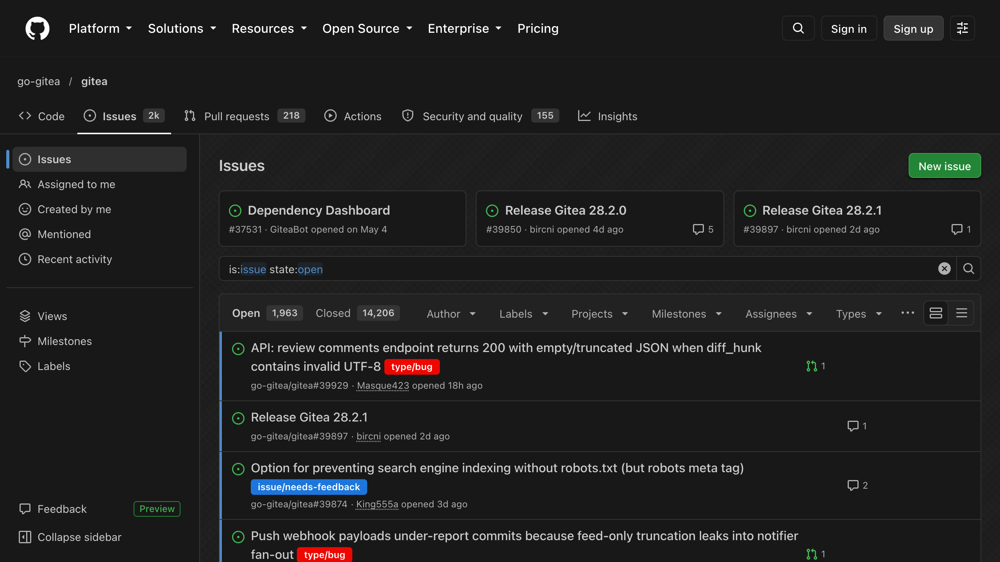

  
   
  
  
  

<h2 align="center">Your eyes will&nbsp;:heart:&nbsp;you.</h2>

## Installation

1. Install [Stylus for Firefox](https://addons.mozilla.org/en-US/firefox/addon/styl-us/), [Chrome](https://chrome.google.com/webstore/detail/stylus/clngdbkpkpeebahjckkjfobafhncgmne) or [Cascadea for Safari](https://cascadea.app/).
2. Install [github-dark.user.css](https://raw.githubusercontent.com/StylishThemes/GitHub-Dark/master/github-dark.user.css).
3. Set GitHub itself to [dark mode](https://github.com/settings/appearance), the style builds on GitHub's dark theme.

The options, like base color, background image and syntax themes, are described in the [wiki](https://github.com/StylishThemes/GitHub-Dark/wiki/Install). For GitHub Enterprise, add `domain("github.example.com")` to both GitHub `@-moz-document` rules in the installed style. Extensions that use GitHub's CSS variables, like [Refined GitHub](https://github.com/refined-github/refined-github), follow the theme automatically.

## Styled Sites

- [github.com](https://github.com)
- [gist.github.com](https://gist.github.com)
- [support.github.com](https://support.github.com)
- [vscode-auth.github.com](https://vscode-auth.github.com)
- [githubstatus.com](https://www.githubstatus.com)
- Raw files on [raw.githubusercontent.com](https://raw.githubusercontent.com/StylishThemes/GitHub-Dark/master/README.md) and gist.githubusercontent.com
- Rendered Jupyter notebooks on notebooks.githubusercontent.com

## Additional Userstyles

⚙️ [GitHub Custom Fonts](https://raw.githubusercontent.com/StylishThemes/GitHub-Dark/master/github-custom-fonts.user.css) 
⚙️ [GitHub Blog Dark](https://github.com/StylishThemes/GitHub-Blog-Dark) 
⚙️ [GitHub Code Wrap](https://github.com/StylishThemes/GitHub-code-wrap) 
⚙️ [GitHub Commit Limit](https://github.com/StylishThemes/GitHub-Commit-Limit) 
⚙️ [GitHub Compact Feed](https://github.com/StylishThemes/GitHub-Compact-Feed) 
⚙️ [GitHub Dark Diff Color Customizer](https://raw.githubusercontent.com/StylishThemes/Feature-Override-Styles/master/github-dark-diff-color-customizer.user.css) 
⚙️ [GitHub Dark Element Borders](https://raw.githubusercontent.com/StylishThemes/Feature-Override-Styles/master/github-dark-element-borders.user.css) 
⚙️ [GitHub Dark IMG Background Color](https://raw.githubusercontent.com/StylishThemes/Feature-Override-Styles/master/github-dark-img-bg-clr.user.css) 
⚙️ [GitHub Feed Icons](https://github.com/StylishThemes/GitHub-Feed-Icons) 
⚙️ [GitHub FixedHeader](https://github.com/StylishThemes/GitHub-FixedHeader) 
⚙️ [GitHub Selected Tab Color](https://github.com/StylishThemes/GitHub-Selected-Tab-Color) 
⚙️ [GitHub Sticky Sidebar](https://github.com/StylishThemes/GitHub-Sticky-Sidebar) 
⚙️ [GitHub Custom Border Radii](https://github.com/StylishThemes/Feature-Override-Styles/blob/master/github-custom-border-radii.user.css) 
⚙️ [Overlay Scrollbars](https://github.com/StylishThemes/Overlay-Scrollbars) 

## Syntax Themes

The GitHub themes color code views, diffs and markdown, the CodeMirror themes color the file and gist editors and the Jupyter themes color notebook previews.

| Theme                      |   GitHub    |  CodeMirror  |    Jupyter   |
|----------------------------|:-----------:|:------------:|:------------:|
| Ayu Mirage                 |      ✔️     |      ❌     |      ❌      |
| Ambiance                   |      ✔️     |      ✔️     |      ❌      |
| Base16 Ocean Dark          |      ❌     |      ✔️     |      ✔️      |
| Chaos                      |      ✔️     |      ❌     |      ❌      |
| Clouds Midnight            |      ✔️     |      ❌     |      ❌      |
| Cobalt                     |      ✔️     |      ✔️     |      ❌      |
| Dracula                    |      ✔️     |      ✔️     |      ✔️      |
| GitHub Dark                |      ✔️     |      ❌     |      ✔️      |
| Idle Fingers               |      ✔️     |      ❌     |      ✔️      |
| Kr Theme                   |      ✔️     |      ❌     |      ❌      |
| Material                   |      ❌     |      ✔️     |      ❌      |
| Merbivore                  |      ✔️     |      ❌     |      ❌      |
| Merbivore Soft             |      ✔️     |      ❌     |      ❌      |
| Mono Industrial            |      ✔️     |      ❌     |      ❌      |
| Mono Industrial Clear      |      ✔️     |      ❌     |      ❌      |
| Monokai                    |      ✔️     |      ✔️     |      ✔️      |
| Monokai Spacegray Eighties |      ✔️     |      ✔️     |      ✔️      |
| Obsidian                   |      ✔️     |      ❌     |      ✔️      |
| One Dark                   |      ✔️     |      ✔️     |      ❌      |
| Pastel on Dark             |      ✔️     |      ✔️     |      ✔️      |
| Railscasts                 |      ✔️     |      ✔️     |      ✔️      |
| Solarized Dark             |      ✔️     |      ✔️     |      ✔️      |
| Terminal                   |      ✔️     |      ❌     |      ❌      |
| Tomorrow Night             |      ✔️     |      ❌     |      ✔️      |
| Tomorrow Night Blue        |      ✔️     |      ❌     |      ✔️      |
| Tomorrow Night Bright      |      ✔️     |      ✔️     |      ✔️      |
| Tomorrow Night Eighties    |      ✔️     |      ✔️     |      ✔️      |
| Twilight (**default**)     |      ✔️     |      ✔️     |      ✔️      |
| Vibrant Ink                |      ✔️     |      ✔️     |      ❌      |
| VS Code Dark Modern        |      ✔️     |      ❌     |      ❌      |

## Development

Edit [`github-dark.user.css`](./github-dark.user.css), there is no build step. It overrides GitHub's [Primer](https://primer.style) CSS variables, plus a few rules with stable selectors for things variables can't reach. Prefer a variable over a rule and never use GitHub's hashed class names.

Run `make install` to test it in Stylus and `make lint` to lint it. Release with `make patch`, `make minor` or `make major`, which bump the version of both styles, then commit, tag and push.
